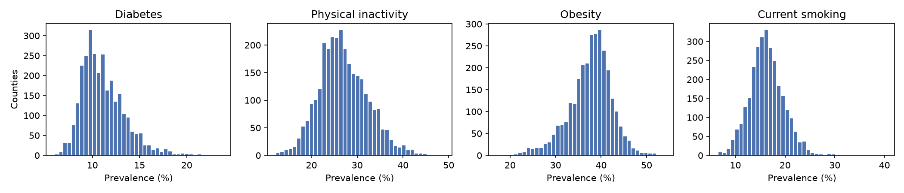
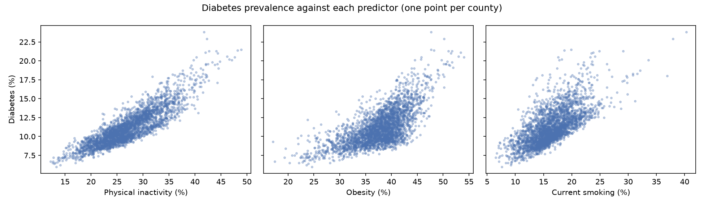
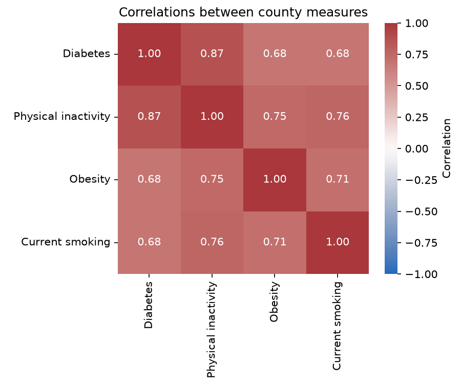
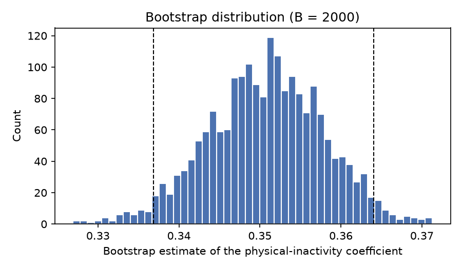
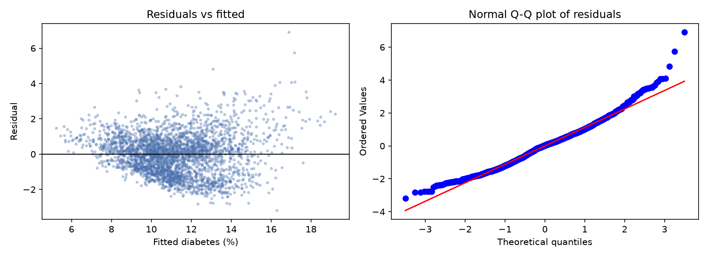
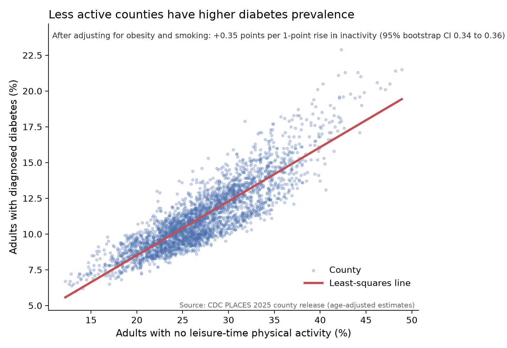

```{python}
#| label: setup
# The report reads the processed data made by notebooks/01_data_processing.ipynb
# and the figures saved by notebooks/02_analysis.ipynb. Run those first.
import os, sys
from pathlib import Path
ROOT = Path.cwd() if (Path.cwd() / "src").is_dir() else Path.cwd().parent
os.chdir(ROOT)
sys.path.insert(0, str(ROOT))

import numpy as np
import pandas as pd
from src.analysis import (describe, design_matrix, ols_fit, coef_table,
                          bootstrap_coefs, percentile_ci)

PROCESSED_PATH = Path("data/processed/county_analysis.csv")
FIGURES = ["eda_histograms.png", "eda_scatter.png", "diagnostics.png",
           "bootstrap_lpa.png", "communication_figure.png",
           "eda_pairplot.png", "corr_heatmap.png"]
missing = [f for f in FIGURES if not (Path("figures") / f).exists()]
if not PROCESSED_PATH.exists() or missing:
    raise FileNotFoundError(
        "Run notebooks/01_data_processing.ipynb and notebooks/02_analysis.ipynb "
        "before rendering this report.")

Y = "diabetes"
X_COLS = ["lpa", "obesity", "csmoking"]
SEED = 556
N_BOOT = 2000

county = pd.read_csv(PROCESSED_PATH, dtype={"locationid": str})

# Same model and bootstrap (same seed) as notebooks/02_analysis.ipynb
X = design_matrix(county, X_COLS)
y = county[Y].to_numpy()
fit = ols_fit(X, y)
boot = bootstrap_coefs(X, y, n_boot=N_BOOT, rng=np.random.default_rng(SEED))
ci = percentile_ci(boot)

# Values quoted in the text
n_counties = f"{len(county):,}"
n_states = county["stateabbr"].nunique()
r2 = f"{fit['r2']:.2f}"
cond = f"{fit['cond']:.0f}"
b_lpa = f"{fit['beta'][1]:.2f}"
lpa_lo, lpa_hi = f"{ci[1, 0]:.2f}", f"{ci[1, 1]:.2f}"
r_lpa = f"{county[[Y, 'lpa']].corr().iloc[0, 1]:.2f}"
r_lpa_ob = f"{county[['lpa', 'obesity']].corr().iloc[0, 1]:.2f}"
```

# Introduction

Diabetes is one of the most common chronic diseases in the United States, and physical inactivity is a well-known risk factor for it. This project asks a county-level version of that question:

> **Across US counties, how strongly is the prevalence of physical inactivity associated with diabetes prevalence, after accounting for obesity and smoking?**

*TODO: one or two sentences on why the question matters (for example, for county public-health planning).*

# Data

The data come from the CDC's **PLACES: Local Data for Better Health**, County Data, 2025 release (dataset `swc5-untb`), downloaded through the public Socrata Open Data API at `https://data.cdc.gov/resource/swc5-untb.json`. No API key is required. PLACES provides model-based estimates of adult health measures for every US county, built from the Behavioral Risk Factor Surveillance System (BRFSS) survey and Census population data.

The unit of observation is a **county** in the 50 states and DC. After cleaning, the analysis uses **`{python} n_counties` counties** across **`{python} n_states`** states and DC combined. All four variables are **age-adjusted prevalences** (% of adults), so counties with older or younger populations can be compared fairly.

| Variable | PLACES measure | Meaning | Role |
|---|---|---|---|
| `diabetes` | `DIABETES` | Diagnosed diabetes | Response |
| `lpa` | `LPA` | No leisure-time physical activity | Main predictor |
| `obesity` | `OBESITY` | Obesity | Control |
| `csmoking` | `CSMOKING` | Current cigarette smoking | Control |

: Analysis variables {#tbl-vars}

**Data limitations.** PLACES values are model-based estimates rather than direct counts, and they describe counties, not individuals. These points are discussed in @sec-limitations.

# Data workflow

All processing is done in `notebooks/01_data_processing.ipynb`, using functions in `src/`:

1. **Download** (`fetch_places`): the API is paginated, so all pages are requested and combined. The raw response is saved unchanged to `data/raw/` with a provenance record (endpoint, query, retrieval date), and later runs read this saved copy.
2. **Validate** (`validate_raw`): checks that required columns and all four measures are present, that no county appears twice for a measure, and that every prevalence lies in [0, 100].
3. **Filter and reshape** (`tidy_places`): keeps the 50 states and DC, converts text to numbers, and pivots the data from one row per county per measure (long) to one row per county (wide).
4. **Missingness** (`missingness_report`, `drop_incomplete`): counties missing any analysis variable are reported and removed (complete-case analysis).
5. **Save**: the analysis-ready table is written to `data/processed/county_analysis.csv`.

*TODO: state how many counties were dropped for missing values and why complete-case analysis is reasonable (see the processing log in notebook 01).*

# Methods

**Least squares.** Diabetes prevalence is modelled as

$$
\text{diabetes}_i = \beta_0 + \beta_1\,\text{lpa}_i + \beta_2\,\text{obesity}_i + \beta_3\,\text{csmoking}_i + \varepsilon_i ,
$$

fit with NumPy linear algebra (`np.linalg.lstsq`), without forming an explicit matrix inverse. The coefficient $\beta_1$ is the expected difference in diabetes prevalence (percentage points) between counties that differ by one percentage point in physical inactivity, holding obesity and smoking fixed.

**Bootstrap.** Uncertainty in the coefficients comes from a case (pairs) bootstrap: each of B = `{python} N_BOOT` bootstrap samples draws `{python} n_counties` counties with replacement, and the model is refit. The 2.5th and 97.5th percentiles of the refitted coefficients form 95% confidence intervals. This does not assume normal, constant-variance errors. The seed is fixed (`np.random.default_rng(556)`) so the results are reproducible.

# Results

## Descriptive summaries

```{python}
#| label: tbl-desc
#| tbl-cap: "Descriptive statistics of the age-adjusted prevalences (% of adults) across counties."
describe(county, [Y] + X_COLS)
```

{#fig-hist}

{#fig-scatter}

{#fig-corr width=70%}

Physical inactivity and diabetes are strongly correlated across counties (r = `{python} r_lpa`). Inactivity is also correlated with obesity (r = `{python} r_lpa_ob`), so part of their association with diabetes overlaps (@fig-corr).

*TODO: describe the shapes of the distributions in @fig-hist and the relationships in @fig-scatter.*

## Least-squares fit and bootstrap intervals

```{python}
#| label: tbl-coef
#| tbl-cap: "Least-squares coefficients with classical and bootstrap standard errors, and 95% bootstrap percentile intervals."
results = coef_table(fit, X_COLS)
results["boot_se"] = boot.std(axis=0, ddof=1).round(4)
results["ci_low"] = ci[:, 0].round(4)
results["ci_high"] = ci[:, 1].round(4)
results
```

Holding obesity and smoking fixed, a county with one percentage point more physical inactivity has, on average, **`{python} b_lpa` percentage points** higher diabetes prevalence (95% bootstrap CI `{python} lpa_lo` to `{python} lpa_hi`). The model explains R² = `{python} r2` of the variation in diabetes prevalence across counties. The condition number of the design matrix is `{python} cond`.

{#fig-boot}

{#fig-diag}

*TODO: interpret the diagnostics in @fig-diag (curvature, unequal spread, heavy tails), the condition number, and how the bootstrap and classical standard errors in @tbl-coef compare.*

## Main result

{#fig-main}

# Discussion and conclusion

*TODO: answer the question in 2–3 sentences, using the estimate and interval above. Comment on what the size of the association means in practice.*

# Limitations {#sec-limitations}

- **Model-based estimates.** PLACES values are small-area estimates from survey data and census covariates, not direct county counts. Their own uncertainty is not included here, and because the estimates share inputs, associations between measures may be overstated.
- **Ecological data.** Associations between counties do not describe individuals.
- **Observational design.** The results are associations, not causal effects. Income, age structure, access to care and other factors are not included.
- **Dependence between counties.** Neighbouring counties tend to be similar, so the bootstrap, which treats counties as independent, likely understates uncertainty.

*TODO: add any other limitations you noticed.*

# Reproducibility

From the repository root: run `notebooks/01_data_processing.ipynb`, then `notebooks/02_analysis.ipynb`, then render this report with

```bash
quarto render final_report.qmd
```

All code is in `src/` and the notebooks, all paths are relative, and the bootstrap uses a fixed seed.
