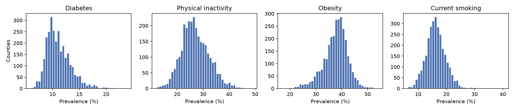
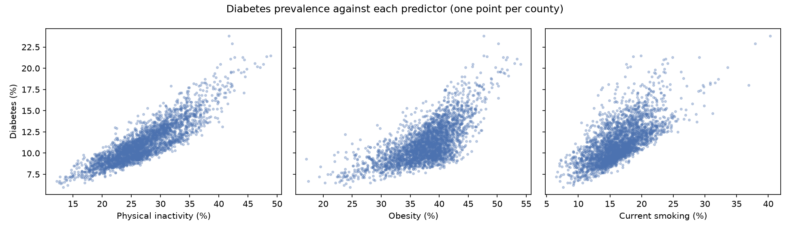
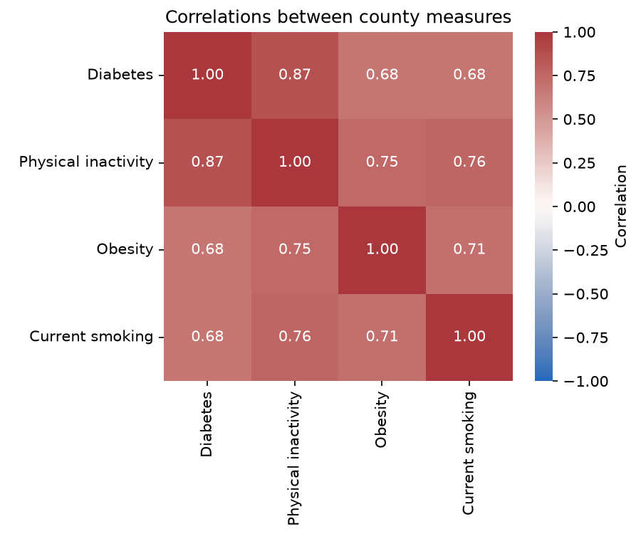
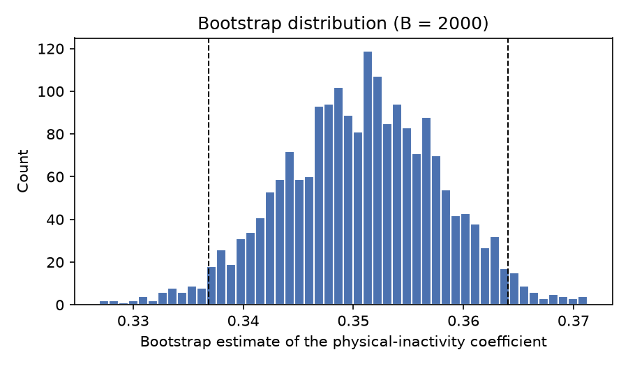
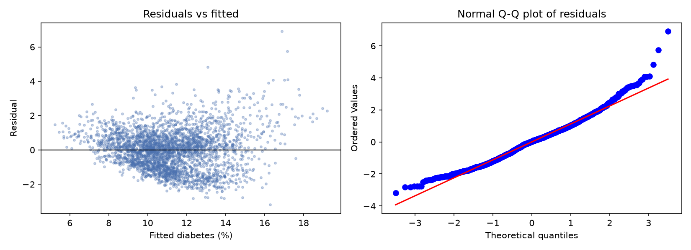
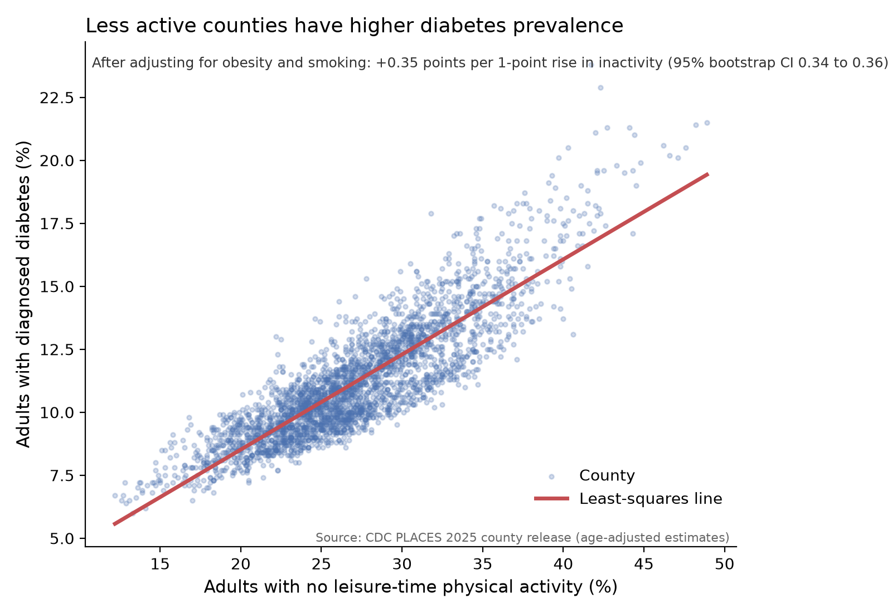

```{python}
#| label: setup
# The report reads the processed data made by notebooks/01_data_processing.ipynb
# and the figures saved by notebooks/02_analysis.ipynb. Run those first.
import os, sys
from pathlib import Path
ROOT = Path.cwd() if (Path.cwd() / "src").is_dir() else Path.cwd().parent
os.chdir(ROOT)
sys.path.insert(0, str(ROOT))

import numpy as np
import pandas as pd
from src.analysis import (describe, design_matrix, ols_fit, coef_table,
                          bootstrap_coefs, percentile_ci)

PROCESSED_PATH = Path("data/processed/county_analysis.csv")
FIGURES = ["eda_histograms.png", "eda_scatter.png", "diagnostics.png",
           "bootstrap_lpa.png", "communication_figure.png",
           "eda_pairplot.png", "corr_heatmap.png"]
missing = [f for f in FIGURES if not (Path("figures") / f).exists()]
if not PROCESSED_PATH.exists() or missing:
    raise FileNotFoundError(
        "Run notebooks/01_data_processing.ipynb and notebooks/02_analysis.ipynb "
        "before rendering this report.")

Y = "diabetes"
X_COLS = ["lpa", "obesity", "csmoking"]
SEED = 556
N_BOOT = 2000

county = pd.read_csv(PROCESSED_PATH, dtype={"locationid": str})

# Same model and bootstrap (same seed) as notebooks/02_analysis.ipynb
X = design_matrix(county, X_COLS)
y = county[Y].to_numpy()
fit = ols_fit(X, y)
boot = bootstrap_coefs(X, y, n_boot=N_BOOT, rng=np.random.default_rng(SEED))
ci = percentile_ci(boot)

# Values quoted in the text
n_counties = f"{len(county):,}"
n_states = county["stateabbr"].nunique()   # 48 states + DC
r2 = f"{fit['r2']:.2f}"
cond = f"{fit['cond']:.0f}"
b_lpa = f"{fit['beta'][1]:.2f}"
b_lpa10 = f"{10 * fit['beta'][1]:.1f}"
lpa_lo, lpa_hi = f"{ci[1, 0]:.2f}", f"{ci[1, 1]:.2f}"
r_lpa = f"{county[[Y, 'lpa']].corr().iloc[0, 1]:.2f}"
r_obes = f"{county[[Y, 'obesity']].corr().iloc[0, 1]:.2f}"
r_smok = f"{county[[Y, 'csmoking']].corr().iloc[0, 1]:.2f}"
r_lpa_ob = f"{county[['lpa', 'obesity']].corr().iloc[0, 1]:.2f}"
_pc = county[X_COLS].corr().to_numpy()[np.triu_indices(3, 1)]
r_pred_lo, r_pred_hi = f"{_pc.min():.2f}", f"{_pc.max():.2f}"   # predictor-predictor correlations
d_mean = f"{county[Y].mean():.1f}"
d_med = f"{county[Y].median():.1f}"
d_max = f"{county[Y].max():.1f}"
d_sd = f"{county[Y].std():.1f}"
```

# Introduction

Diabetes is one of the most common chronic diseases in the United States, and physical inactivity is a well-known risk factor for it. This project asks a county-level version of that question:

> **Across US counties, how strongly is the prevalence of physical inactivity associated with diabetes prevalence, after accounting for obesity and smoking?**

The answer matters for local public-health planning. County health departments often have to decide where to place prevention programs, such as walking and exercise initiatives, and direct survey data are rarely available for small counties. If inactivity tracks diabetes closely even after accounting for obesity and smoking, then county-level inactivity estimates can help identify where such programs may be most needed.

# Data

The data come from the CDC's **PLACES: Local Data for Better Health**, County Data, 2025 release (dataset `swc5-untb`), downloaded through the public Socrata Open Data API at `https://data.cdc.gov/resource/swc5-untb.json`. No API key is required. PLACES provides model-based estimates of adult health measures for every US county, built from the Behavioral Risk Factor Surveillance System (BRFSS) survey and Census population data.

The unit of observation is a **county** in 48 states and DC (Kentucky and Pennsylvania have no estimates for these measures in the 2025 release). After cleaning, the analysis uses **`{python} n_counties` counties** across **`{python} n_states` jurisdictions** (48 states plus DC). All four variables are **age-adjusted prevalences** (% of adults), so counties with older or younger populations can be compared fairly.

| Variable | PLACES measure | Meaning | Role |
|---|---|---|---|
| `diabetes` | `DIABETES` | Diagnosed diabetes | Response |
| `lpa` | `LPA` | No leisure-time physical activity | Main predictor |
| `obesity` | `OBESITY` | Obesity | Control |
| `csmoking` | `CSMOKING` | Current cigarette smoking | Control |

: Analysis variables {#tbl-vars}

**Data limitations.** PLACES values are model-based estimates rather than direct counts, and they describe counties, not individuals. These points are discussed in @sec-limitations.

# Data workflow

All processing is done in `notebooks/01_data_processing.ipynb`, using functions in `src/`:

1. **Download** (`fetch_places`): the API is paginated, so all pages are requested and combined. The raw response is saved unchanged to `data/raw/` with a provenance record (endpoint, query, retrieval date), and later runs read this saved copy.
2. **Validate** (`validate_raw`): checks that required columns and all four measures are present, that no county appears twice for a measure, and that every prevalence lies in [0, 100].
3. **Filter and reshape** (`tidy_places`): removes the national total and territory rows, keeps the 48 states and DC that have estimates, converts text to numbers, and pivots the data from one row per county per measure (long) to one row per county (wide).
4. **Missingness** (`missingness_report`, `drop_incomplete`): counties missing any analysis variable are reported and removed (complete-case analysis).
5. **Save**: the analysis-ready table is written to `data/processed/county_analysis.csv`.

Only one county was dropped for missing values: Loving County, Texas, which has all four estimates suppressed by the CDC (it has a very small population). That is 1 of 2,957 counties (0.03%), so `{python} n_counties` counties remain. Complete-case analysis is reasonable here because the missingness is confined to a single county and that county is missing every variable, so there is nothing to impute from and no pattern of missingness that could bias the results (see the processing log in notebook 01).

# Methods

**Least squares.** Diabetes prevalence is modelled as

$$
\text{diabetes}_i = \beta_0 + \beta_1\,\text{lpa}_i + \beta_2\,\text{obesity}_i + \beta_3\,\text{csmoking}_i + \varepsilon_i ,
$$

fit with NumPy linear algebra (`np.linalg.lstsq`), without forming an explicit matrix inverse. The coefficient $\beta_1$ is the expected difference in diabetes prevalence (percentage points) between counties that differ by one percentage point in physical inactivity, holding obesity and smoking fixed.

**Bootstrap.** Uncertainty in the coefficients comes from a case (pairs) bootstrap: each of B = `{python} N_BOOT` bootstrap samples draws `{python} n_counties` counties with replacement, and the model is refit. The 2.5th and 97.5th percentiles of the refitted coefficients form 95% confidence intervals. This does not assume normal, constant-variance errors. The seed is fixed (`np.random.default_rng(556)`) so the results are reproducible.

# Results

## Descriptive summaries

```{python}
#| label: tbl-desc
#| tbl-cap: "Descriptive statistics of the age-adjusted prevalences (% of adults) across counties."
describe(county, [Y] + X_COLS)
```

{#fig-hist}

{#fig-scatter}

{#fig-corr width=70%}

All four measures are positively correlated (@fig-corr). Physical inactivity has by far the strongest correlation with diabetes (r = `{python} r_lpa`), while obesity and smoking have r = `{python} r_obes` and `{python} r_smok`. The predictors are also strongly correlated with one another (r = `{python} r_pred_lo` to `{python} r_pred_hi`, including inactivity with obesity at r = `{python} r_lpa_ob`), so they carry overlapping information (collinearity) and their separate effects must be interpreted with care.

**Distributions (@fig-hist).** Diabetes prevalence is right-skewed (mean `{python} d_mean`% vs median `{python} d_med`%): most counties fall between about 8% and 13%, with a peak near 10% and a long upper tail reaching `{python} d_max`%. Physical inactivity is roughly symmetric around 26 to 27% with a slight right tail up to about 49%. Obesity is left-skewed: most counties lie between about 33% and 43%, with a tail of lower-obesity counties down to about 17%. Smoking is roughly symmetric around 16%, but a handful of counties have very high rates (30 to 40%).

**Relationships (@fig-scatter).** Physical inactivity has the strongest and tightest relationship with diabetes: the points follow a clear, nearly linear upward trend, with a slight upward bend above about 35% inactivity. Obesity and smoking show weaker positive relationships with much more scatter. The obesity pattern looks curved, and the smoking plot fans out as smoking increases. In all three plots the vertical spread of diabetes grows at higher predictor values, which suggests unequal variance in the regression.

## Least-squares fit and bootstrap intervals

```{python}
#| label: tbl-coef
#| tbl-cap: "Least-squares coefficients with classical and bootstrap standard errors, and 95% bootstrap percentile intervals."
results = coef_table(fit, X_COLS)
results["boot_se"] = boot.std(axis=0, ddof=1).round(4)
results["ci_low"] = ci[:, 0].round(4)
results["ci_high"] = ci[:, 1].round(4)
se_c = {k: f"{results.loc[k, 'std_error']:.4f}" for k in X_COLS}   # classical SEs
se_b = {k: f"{results.loc[k, 'boot_se']:.4f}" for k in X_COLS}     # bootstrap SEs
se_lpa_c, se_lpa_b = se_c["lpa"], se_b["lpa"]
se_ob_c, se_ob_b = se_c["obesity"], se_b["obesity"]
se_sm_c, se_sm_b = se_c["csmoking"], se_b["csmoking"]
sm_pct = f"{100 * (results.loc['csmoking', 'boot_se'] / results.loc['csmoking', 'std_error'] - 1):.0f}"
results
```

Holding obesity and smoking fixed, a county with one percentage point more physical inactivity has, on average, **`{python} b_lpa` percentage points** higher diabetes prevalence (95% bootstrap CI `{python} lpa_lo` to `{python} lpa_hi`). The model explains R² = `{python} r2` of the variation in diabetes prevalence across counties. The condition number of the design matrix is `{python} cond`.

{#fig-boot}

{#fig-diag}

**Diagnostics (@fig-diag).** The residuals are centered near zero but show two departures from the model's assumptions. First, there is mild curvature: residuals tend to be positive for counties with low fitted values (below about 8%) and high fitted values (above about 15%), and negative in between, so the true relationship is somewhat non-linear. Second, the spread is not constant: residuals fan out at higher fitted values, and a few counties have large positive residuals (up to about 7 percentage points). In the normal Q-Q plot the residuals follow the line in the middle, but the upper tail lies well above it and the lower tail is shorter than normal, so the residuals are right-skewed. Because the error variance is unequal and the residuals are not normal, the classical standard errors may be unreliable, which motivates the bootstrap.

**Condition number.** The condition number of the design matrix is `{python} cond`. This is moderate rather than severe: part of it comes from the intercept column and the predictors being on different scales, and part reflects the strong correlations among the predictors (r = `{python} r_pred_lo` to `{python} r_pred_hi`). The coefficients can still be estimated precisely because the sample is large, but the separate effects of inactivity, obesity and smoking should be interpreted with care, since the predictors carry overlapping information.

**Bootstrap versus classical standard errors (@tbl-coef).** The bootstrap standard errors are larger than the classical ones: slightly for inactivity (`{python} se_lpa_b` vs `{python} se_lpa_c`) and obesity (`{python} se_ob_b` vs `{python} se_ob_c`), and by about `{python} sm_pct`% for smoking (`{python} se_sm_b` vs `{python} se_sm_c`). This is consistent with the unequal error variance seen in the residual plot, under which the classical standard errors understate the uncertainty. The 95% bootstrap interval for the inactivity coefficient is narrow and far from zero (@fig-boot), so the inactivity result is stable. The interval for smoking includes zero, so there is no clear association between smoking and diabetes once inactivity and obesity are in the model.

**Monte Carlo variability.** Because the bootstrap resamples counties at random, a different seed would give slightly different intervals. With B = `{python} N_BOOT` the difference is tiny (only in the third decimal place), so the conclusions do not depend on the seed, and the fixed seed makes the results exactly reproducible.

## Main result

{#fig-main}

Diabetes prevalence rises steadily with inactivity, from about 6% in the most active counties to about 20% in the least active. The annotation on the figure reports the adjusted estimate from the full model: holding obesity and smoking fixed, each 1-point rise in inactivity is associated with about `{python} b_lpa` percentage points more diabetes (95% bootstrap CI `{python} lpa_lo` to `{python} lpa_hi`). The points spread out and bend slightly upward at high inactivity, consistent with the curvature and unequal variance seen in the diagnostics.

# Discussion and conclusion

Counties with more physical inactivity tend to have higher diabetes prevalence, even after accounting for obesity and smoking. Each additional percentage point of inactivity is associated with about `{python} b_lpa` percentage points more diabetes (95% bootstrap CI `{python} lpa_lo` to `{python} lpa_hi`), and the model explains `{python} r2` of the variation across counties. In practical terms, a 10-point difference in inactivity corresponds to about `{python} b_lpa10` points more diabetes, which is larger than one standard deviation of county diabetes prevalence (`{python} d_sd` points). Once inactivity is in the model, obesity and smoking add little. This is a substantial difference for planning purposes. Because the data are ecological and observational, these are associations between counties and not evidence that increasing activity would cause diabetes to fall in a given person or place.

# Limitations {#sec-limitations}

- **Model-based estimates.** PLACES values are small-area estimates from survey data and census covariates, not direct county counts. Their own uncertainty is not included here, and because the estimates share inputs, associations between measures may be overstated.
- **Ecological data.** Associations between counties do not describe individuals.
- **Observational design.** The results are associations, not causal effects. Income, poverty, age structure, diet, rurality, access to health care and other factors are not in the model and may explain part of the association.
- **Dependence between counties.** Neighbouring counties tend to be similar, so the bootstrap, which treats counties as independent, likely understates uncertainty.

- **Overlapping predictors.** Inactivity and obesity are correlated, so their separate coefficients are harder to pin down than their combined association with diabetes.
- **Model fit.** Residual plots show mild curvature, unequal variance and right-skewed errors, so a straight-line model does not fully capture the relationship. A squared term or a log-transformed response might fit better.
- **Measurement.** The measures come from survey answers. Inactivity counts only leisure-time activity, so adults with physically demanding jobs can be classed as inactive, and diabetes counts only diagnosed cases, so undiagnosed diabetes is missed.
- **Coverage.** Kentucky and Pennsylvania have no estimates for these measures in the 2025 release, and Loving County, Texas was dropped for missing values, so the results apply to 48 states plus DC.

# Reproducibility

From the repository root: run `notebooks/01_data_processing.ipynb`, then `notebooks/02_analysis.ipynb`, then render this report with

```bash
quarto render final_report.qmd
```

All code is in `src/` and the notebooks, all paths are relative, and the bootstrap uses a fixed seed.
